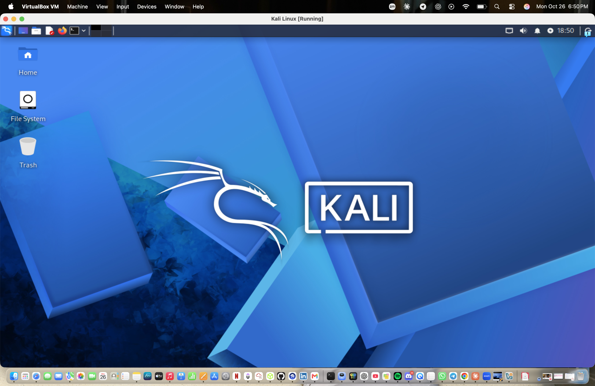
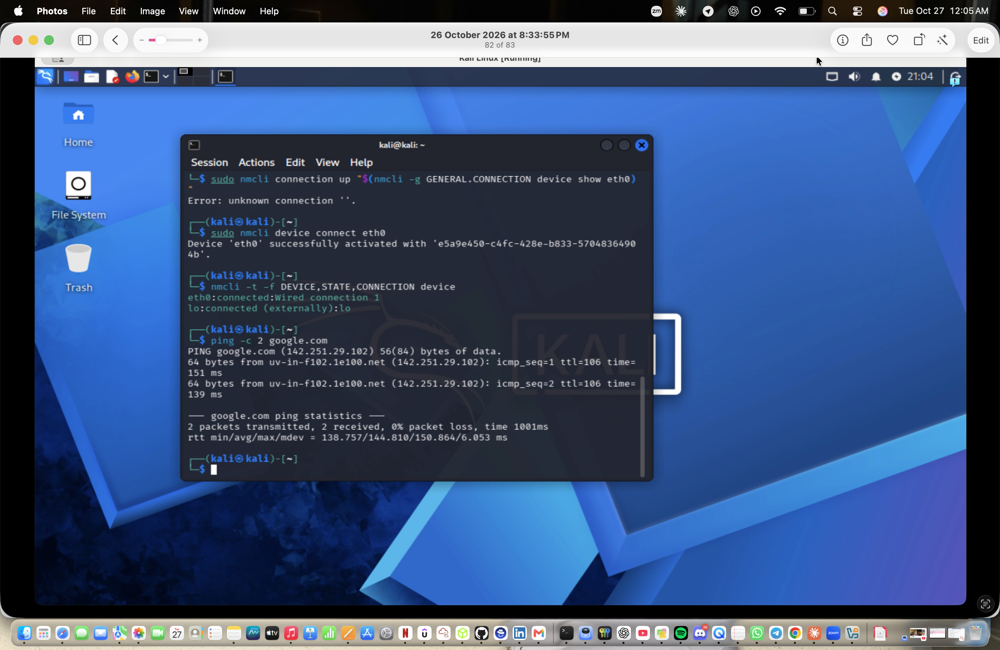
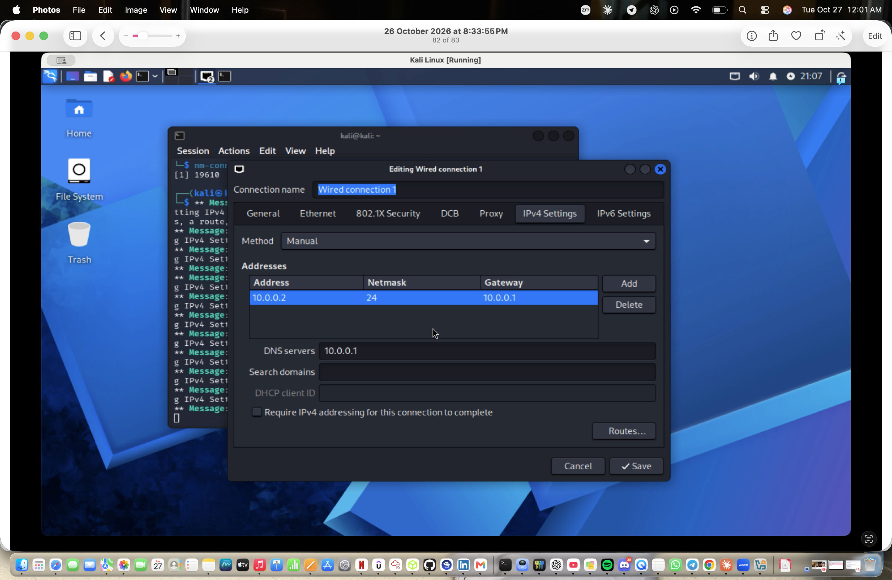

# 🖥️ Cybersecurity & Pentesting Lab Setup (Apple Silicon Edition)

**NETWORKWALKS | Project 1 | Tools: VirtualBox + Kali Linux (ARM64) on a MacBook Air M4**

---

## 📌 Project Overview

This project covers the design and deployment of an **isolated virtual cybersecurity lab** using VirtualBox and Kali Linux on an Apple Silicon MacBook.

The lab gives me a safe, repeatable environment for practicing security testing without putting my host machine or home network at risk. It runs on a private virtual network, so additional machines can be added later as targets for authorized testing.

---

## 🎯 Objectives

- Install and configure VirtualBox on macOS.
- Install Kali Linux (ARM64) as a virtual machine.
- Create a private **NAT Network** for the lab.
- Configure and verify network connectivity for the Kali VM.
- Assign a consistent IP address and configure the project's DNS server.
- Create a clean VM snapshot for recovery.
- Document the full process, including problems and fixes.

---

## 🛡️ Purpose of the Lab

The lab is a controlled space for learning and authorized security work such as:

- Network reconnaissance and port scanning
- Vulnerability assessment
- Packet analysis
- Web security testing
- Security tool experimentation

⚠️ **Important:** Use this lab only on systems you own or have explicit written permission to test. It is for education and authorized practice only.

---

## 🏗️ Lab Architecture


Kali Linux connects to a VirtualBox NAT Network (`NatNetwork`). VMs on this network can talk to each other and reach the internet, while staying separate from the host's real network.

---

## ⚙️ Lab Configuration

| 🧩 Component | ⚙️ Configuration |
| --- | --- |
| 💻 Host Machine | MacBook Air (Apple M4) |
| 🍎 Host OS | macOS Tahoe 26.6.2 |
| 🧰 Hypervisor | Oracle VirtualBox 7.2.22 |
| 🐉 Security OS | Kali Linux 2026.3 (ARM64) |
| 💾 VM Disk | ~41 GB virtual disk |
| 🧠 Kali RAM | 4096 MB |
| 🌐 Virtual Network | NAT Network (`NatNetwork`) |
| 📡 Network Address | 10.0.0.0/24 (DHCP enabled) |
| 🐧 Kali IP Address | 10.0.0.2/24 |
| 🚪 Default Gateway | 10.0.0.1 |
| 🌍 DNS Server | 10.0.0.1 |
| 🔌 Network Profile | Wired connection 1 (`eth0`) |

---

# 🪜 Lab Setup Procedure

## Step 1. Install VirtualBox

Installed Oracle VirtualBox 7.2.22 on macOS as the hypervisor.


---

## Step 2. Create the NAT Network

Created a dedicated NAT Network in VirtualBox:

```
Network Name: NatNetwork
IPv4 Prefix:  10.0.0.0/24
DHCP:         Enabled
```


A **NAT Network** was chosen over plain NAT because VMs on the same NAT Network can communicate with each other while still having outbound internet access. This suits a multi-machine lab with attacker and target VMs.

---

## Step 3. Install Kali Linux (ARM64)

Installed Kali Linux 2026.3 from the **ARM64 Installer ISO**, because the MacBook's Apple M4 chip uses the ARM64 architecture.

The VM was allocated 4096 MB of RAM, and its network adapter was set to:

```
Adapter 1
Attached to: NAT Network
Name:        NatNetwork
```




---

## Step 4. Fix and Verify the Kali Network Connection

The VM initially showed **Wired connection 1 — disconnected**. After troubleshooting (see *Problems Encountered*), the connection came up and received an address from the NAT Network's DHCP server (`10.0.0.3/24` on `eth0`), and internet and DNS tests succeeded.



---

## Step 5. Configure the IP Address and DNS Server

Using the IPv4 Settings of the network connection, I set a consistent address and the project's DNS server:

```
IP Address:  10.0.0.2
Subnet Mask: 255.255.255.0
Gateway:     10.0.0.1
DNS:         10.0.0.1
```

A consistent IP address makes the lab easier to document and to reference in future exercises.



---

## Step 6. Create a Clean VM Snapshot

After the network was working and configured, I created a VirtualBox snapshot as a clean baseline:

```
Snapshot name: Fresh Kali Linux
```

If a future exercise breaks the VM, I can restore this known-good state.


---

# 🔎 Lab Verification

| Test | Command | Expected Result |
| --- | --- | --- |
| 🌐 Check IP address | `ip -4 addr show eth0` | `10.0.0.2/24` shown |
| 📡 Test gateway | `ping -c 4 10.0.0.1` | Replies received, 0% packet loss |
| 🌍 Test internet by IP | `ping -c 4 8.8.8.8` | Replies received, 0% packet loss |
| 🔎 Test DNS resolution | `ping -c 4 google.com` | Name resolves, replies received |
| 🧩 Check configured DNS | `nmcli device show eth0 \| grep DNS` | `10.0.0.1` listed |
| 🔄 Verify snapshot | Restore snapshot, run `ip -4 addr show eth0` | Baseline configuration restored |


---

# 🐞 Problems Encountered & Solutions

Documenting problems is part of professional technical work, so here is what went wrong and how I fixed it.

## Problem 1. Wrong CPU Architecture (AMD64 vs ARM64)

**Symptom:** My first VM setup used an AMD64 (x86-64) image and would not run properly on my MacBook.

**Cause:** AMD64 images are built for Intel/AMD processors. The Apple M4 is an **ARM64** chip, so it needs ARM64 images.

**Fix:** Rebuilt the VM using the **Kali Linux ARM64 Installer ISO**.

**Lesson:** Always check the host CPU architecture before downloading VM images.

---

## Problem 2. "Wired connection 1" Disconnected / `unknown connection` Error

**Symptom:** The network icon showed *Wired connection 1 — disconnected*, and `nmcli` commands from the project guide returned:

```
Error: unknown connection 'Wired connection 1'
```

**Cause:** Connection names in `nmcli` are exact and case-sensitive, and a retyped or copied name (wrong capitalization or curly quotes) is not recognized. The profile also was not active at the start.

**Fix:** I checked the real device and profile names instead of guessing:

```
nmcli -t -f DEVICE,TYPE,STATE,CONNECTION device
```

Then I applied the workaround from the guide, letting NetworkManager supply the exact profile name:

```
sudo nmcli connection modify "$(nmcli -g GENERAL.CONNECTION device show eth0)" ipv4.dad-timeout 0
```

This disables the address-conflict (DAD) wait that can delay the connection on VirtualBox 7 with newer Kali releases. To reconnect after taking the connection down, I activated by **device** rather than profile name:

```
sudo nmcli device connect eth0
```

**Lesson:** After a connection is taken down, `eth0` no longer reports a profile name, so use the device name (`eth0`) to bring it back. Also, the desktop network icon can show a stale status, so verify the real state in the terminal.

---

# 💡 What I Learned

1. **CPU architecture matters in virtualization.** Images must match the host (ARM64 for Apple Silicon).
2. **NAT vs NAT Network.** NAT Network lets lab VMs reach each other and the internet, which a plain NAT setup does not.
3. **Linux network troubleshooting.** Using `nmcli` and `ip` to inspect devices, profiles, and DHCP leases.
4. **IP and DNS configuration.** Setting an address, gateway, and DNS server, then testing by IP first and by name second to isolate problems.
5. **Snapshots.** Saving a clean baseline before any risky testing.
6. **Documentation.** Recording commands, screenshots, and problems so others can reproduce the work.

---

# 🔐 Security & Ethical Use

This laboratory is for education and authorized security testing only.

---

# 🔗 Tools & Resources

- **VirtualBox:** <https://www.virtualbox.org/wiki/Downloads>
- **Kali Linux:** <https://www.kali.org/get-kali/>

---

# 👤 Author

**Oluwaseun Feyisayo Olatunji**
Cybersecurity Project Work | NETWORKWALKS

LinkedIn: <https://www.linkedin.com/in/oluwaseun-olatunji-b7790927b>

---

## 📌 Project Information

**Program:** Cybersecurity Program, NETWORKWALKS
**Week:** 01
**Project:** Cybersecurity & Pentesting Lab Setup
**Repository:** GitHub
